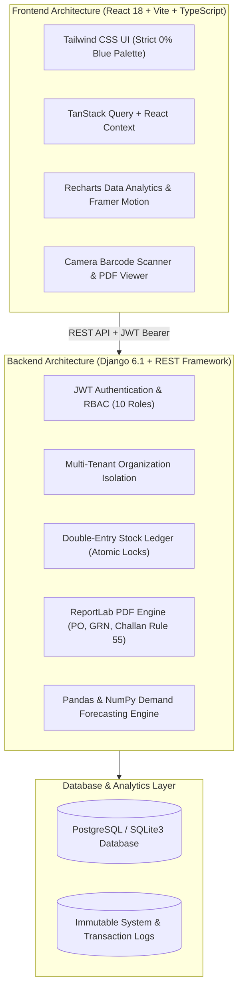

# StockPilot — Intelligent Warehouse & Inventory Management System

> **Tagline:** *“Every Item Accounted For. Every Warehouse Connected.”*
> 
> Designed specifically for Indian distributors, wholesalers, manufacturers, retailers, and small-to-medium enterprises (SMEs).

---

## 1. System Architecture & Overview

StockPilot is an enterprise-grade warehouse management, procurement, fulfillment, and predictive demand replenishment platform built on modern software architecture.



---

## 2. Strict Visual Design System — 100% Blue-Free

StockPilot strictly adheres to a warm, sophisticated Indian business software palette:

| Color Token | Hex Code | Visual Application |
|---|---|---|
| **Primary Forest** | `#14532D` | Primary action buttons, brand marks, active navigation |
| **Secondary Emerald** | `#15803D` | Secondary buttons, positive variances, stock badges |
| **Accent Green** | `#22C55E` | Trend indicators, forecast projections, success accents |
| **Deep Charcoal** | `#1F2933` | Primary headings, dark mode surfaces, tooltip cards |
| **Warm Ivory** | `#FAFAF7` | Base application background, warm light mode surfaces |
| **Off-White Surface** | `#FFFFFF` | Dashboard card containers, tables, modal dialogs |
| **Muted Sage** | `#E7F2E8` | Secondary borders, table headers, soft sage theme |
| **Warm Amber** | `#F59E0B` | Reorder warnings, low-stock alerts, pending approvals |
| **Terracotta** | `#C65D3A` | Safety stock threshold lines, quarantine indicators |
| **Soft Red Alert** | `#DC2626` | Critical stockouts, discrepancy recounts, rejections |

### 3 Appearance Themes
- **Light Theme:** Warm ivory canvas with crisp white cards and forest green branding.
- **Dark Theme:** Deep charcoal surfaces (`#1F2933`) with comfortable contrast and muted green accents.
- **Soft Sage Theme:** Calming botanical tones with muted sage backgrounds (`#E7F2E8`).

---

## 3. Technology Stack

- **Frontend:**
  - React 18 with Vite
  - TypeScript (Strict type safety)
  - Tailwind CSS v3.4 (Tailored Indian business palette)
  - React Router v6
  - Framer Motion & Motion primitives
  - Recharts (Area charts, bar charts, forecast trajectories)
  - Lucide React (Uniform iconography)
  - TanStack React Query

- **Backend:**
  - Python 3.12+
  - Django 6.1 & Django REST Framework
  - SimpleJWT Authentication
  - ReportLab (Local PDF generation for POs, GRNs, Delivery Challans, and Audit Reports)
  - QRCode & Python-Barcode (Local Code 128 & QR generation without external APIs)
  - Pandas & NumPy (Time-series demand analytics, Holt-Winters exponential smoothing, safety stock)

- **Localization:**
  - Currency: Indian Rupee (`INR - ₹`) with Indian numeral comma grouping (`₹24,56,800.00`)
  - Timezone: `Asia/Kolkata` (IST - UTC+05:30)
  - Taxation: GSTIN (15-char), PAN (10-char), HSN codes, GST rates (0%, 5%, 12%, 18%, 28%)
  - Logistics: CGST Rule 55 Delivery Challan compliance for goods transport

---

## 4. Modular Domain Applications (18 Modules)

1. **`accounts`**: Custom User model, JWT authentication, and Organization tenant scoping.
2. **`warehouses`**: Multi-tier coordinate hierarchy: `Warehouse / Zone / Aisle / Rack / Shelf / Bin` (e.g. `WH-BHW-01/Z-A/A01/R02/S01/BIN-03`).
3. **`catalog`**: Product catalog, hierarchical categories, HSN codes, GST brackets, and SKU generation.
4. **`inventory`**: Traceable double-entry stock ledger, on-hand/reserved/available balance tracking, and inter-hub transfers.
5. **`procurement`**: Purchase order lifecycle (`Draft -> Approved -> Sent -> Received`), Goods Receipt Notes (GRN), and ReportLab PDF PO export.
6. **`suppliers`**: Supplier directory, GSTIN/PAN records, lead time tracking, and empirical on-time delivery scoring.
7. **`sales`**: Customer directory, sales orders, atomic reservation locks preventing overselling, and commercial tax invoice PDFs.
8. **`dispatch`**: Shipments, transporters (VRL, Delhivery, BlueDart), vehicle numbers, e-way bill reference fields, and Rule 55 Delivery Challans.
9. **`barcodes`**: Code 128 / QR code generation, camera-based scanning, keyboard-wedge scanning, and printable PDF label sheets.
10. **`audits`**: Physical stocktaking sessions, blind counting interface, variance analysis, supervisor approval, and ledger reconciliation.
11. **`forecasting`**: Local Pandas/NumPy predictive engine with exponential smoothing, safety stock formula ($1.65 \times \sigma \times \sqrt{L}$), and automated PO draft creation.
12. **`reporting`**: 16 standard enterprise reports (stock valuation, movement, aging, supplier performance) with instant CSV export.
13. **`notifications`**: Internal notification center with severity tags (Critical, Warning, Info) and deep links.
14. **`users`**: Role-Based Access Control (RBAC) with 10 specialized Indian business roles.
15. **`settings`**: Organization settings, GSTIN, PAN, financial year start month (April default), and theme switcher.
16. **`auditlog`**: System security and transaction audit logs capturing IP, user, and module event payloads.
17. **`common`**: Shared utilities, INR currency formatting, and code generators.

---

## 5. Demonstration Seed Data & Credentials

The application is pre-seeded with a fictional Indian distribution enterprise:

- **Company Name:** Bharat DistroLogix Pvt Ltd (`BDL`)
- **GSTIN:** `27AABCB1234F1Z8` | **PAN:** `AABCB1234F`
- **Registered Office:** Unit 402, LogiPark Central, Andheri East, Mumbai, Maharashtra - 400069
- **Fulfillment Hubs:**
  1. `WH-BHW-01`: Bhiwandi Central Distribution Hub (Maharashtra, 50,000 sq.ft)
  2. `WH-GGN-02`: Gurugram NCR Regional Fulfillment Center (Haryana, 35,000 sq.ft)
  3. `WH-BLR-03`: Peenya Industrial Hub (Bengaluru, Karnataka, 40,000 sq.ft)

### Demonstration User Accounts
*(Default Password for all seed accounts:* `StockPilot@2026`*)*

| Email | Role | Operational Scope |
|---|---|---|
| `admin@stockpilot.in` | Organization Owner | Global root access across all hubs and settings |
| `warehouse.mgr@stockpilot.in` | Warehouse Manager | Floor operations, bins, receipts, and movements |
| `procurement@stockpilot.in` | Procurement Officer | PO creation, vendor catalog, and GRN receiving |
| `sales@stockpilot.in` | Sales Manager | Customer orders, reservations, and dispatch requests |
| `auditor@stockpilot.in` | Stock Auditor | Blind cycle counts and variance reconciliation |

---

## 6. Quick Start & Local Execution

### Prerequisites
- Python 3.12+
- Node.js 18+ and npm

### Backend Setup (Windows PowerShell)
```powershell
cd backend
python -m venv venv
.\venv\Scripts\Activate.ps1
pip install django djangorestframework django-cors-headers djangorestframework-simplejwt reportlab qrcode python-barcode pandas numpy
python manage.py migrate
python manage.py seed_demo_data
python manage.py runserver 127.0.0.1:8000
```

### Backend Setup (Linux / macOS)
```bash
cd backend
python3 -m venv venv
source venv/bin/activate
pip install django djangorestframework django-cors-headers djangorestframework-simplejwt reportlab qrcode python-barcode pandas numpy
python manage.py migrate
python manage.py seed_demo_data
python manage.py runserver 127.0.0.1:8000
```

### Frontend Setup
```bash
cd frontend
npm install
npm run dev
```

Visit `http://localhost:5173` in your browser.

---

## 7. Automated Testing

### Backend Test Suite
```bash
cd backend
python manage.py test apps.common.tests
```
Verifies:
- Double-entry stock ledger atomic consistency
- Overselling protection via database-level reservation locks
- Demand forecasting safety stock formulas and reorder recommendations
- Role-based permissions and token authentication

### Frontend Production Build
```bash
cd frontend
npm run build
```

---

## 8. Demand Forecasting Methodology

The StockPilot forecasting engine runs 100% locally using Pandas and NumPy:
1. **Demand Aggregation:** Empirical sales aggregated on daily and weekly buckets.
2. **Exponential Smoothing:** Holt-Winters single/double exponential smoothing with dampening parameter $\alpha = 0.30$.
3. **Safety Stock Formula:**
   $$\text{Safety Stock} = Z \times \sigma_d \times \sqrt{L}$$
   Where $Z = 1.65$ represents a 95% service level cycle target, $\sigma_d$ is daily demand standard deviation, and $L$ is vendor lead time in days.
4. **Reorder Point (ROP):**
   $$\text{ROP} = (\text{Avg Daily Demand} \times L) + \text{Safety Stock}$$
5. **Human-in-the-Loop Approval:** Supervisors can inspect the mathematical explainability breakdown and convert recommendations directly into Draft Purchase Orders with one click.

---

## 9. Codebase Size & Metric Auditing

To measure lines of code across production code, tests, and documentation:
```bash
python measure_codebase.py
```

---

## 10. License

Developed for enterprise warehouse and logistics management. All demonstration company data and transaction records are fictional samples.
